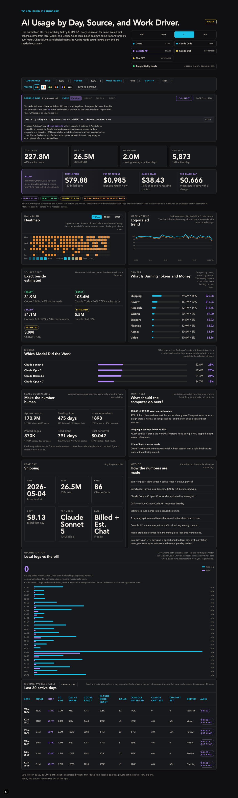

# Token Burn Dashboard

A local dashboard for AI token usage and spend, across Codex, Claude Code
(CLI + desktop agent sessions), Claude chat, ChatGPT, and the Anthropic Console
API — all on one set of axes, with **measured, billed, derived and estimated
values kept visibly separate**.

Everything runs locally. No usage data leaves the machine, and the one credential
involved never touches the repo.



> The figures in the preview and in `dashboard/data/daily-burn.sample.json` are
> **synthetic**. They exist so a fresh clone renders something; they are not
> anyone's real usage.

---

## Credit

This project began from **[Build your own token-burn dashboard](https://unlock-ai.natebjones.com/guides/build-your-own-token-burn-dashboard)**,
a build guide by **Nate B. Jones** at [Unlock AI](https://unlock-ai.natebjones.com).
The guide supplied the original idea and the shape worth copying: normalize every
source into one row per day, and label how much you trust each number.

Credit for the concept goes there. It is a paid guide, and **this repository
contains none of its files** — no starter application, no kit skill or spec
documents, no copy of the guide itself. Everything here is a reimplementation
that has since diverged substantially. If the idea is useful to you, buy the
guide.

## What changed from the original concept

The starter was five views over one normalized table. This keeps that spine and
adds the parts that make the numbers trustworthy rather than merely present.

**A fourth trust tier, and real money.** The original separated *exact* from
*estimated*. This adds **billed** — Anthropic's own meter via the Usage & Cost
Admin API — which outranks local logs because it is what settles the invoice.
With it comes the first dollar axis: total spend, blended $/1M tokens, the share
of the bill spent re-reading cached context, and cost per driver.

**Cache reads are first-class.** Every view separates cache reads from fresh
tokens, because a dashboard that hides them will tell you your usage doubled
when what actually happened is that a session got long.

**It reconciles against the bill.** Days seen by both a local log and the meter
are compared directly. Crucially the comparison is read in **one direction
only**: `billed > local` means work your logs missed and is actionable;
`local > billed` is expected on mixed billing, because subscription traffic never
reaches an organization's meter. A single drift percentage would be meaningless.

**Clock correctness.** Usage is fetchable hourly, but cost and Claude Code
analytics arrive on UTC days while the dashboard's rows are local days. Joining
them on a date string misfiles 7–8 hours of every day and silently corrupts both
the overlap subtraction and the reconciliation. Each UTC day is therefore
apportioned across the local days it spans using the measured hourly token
distribution, **per token type**, so a local day that took the cache-read-heavy
half of a UTC day is charged at cache-read rates. Window totals stay exact.

**No double counting.** When Claude Code is billed through an API key it appears
in both the local logs and the meter. The overlap is detected from the analytics
endpoint's `customer_type` and subtracted per day.

**Additions to the original five views:** a per-model breakdown, a billed-vs-local
reconciliation panel, a money strip, a cost heatmap mode, and fractional driver
splits for days that belong to more than one kind of work.

**Operational hardening the guide did not cover:** credentials in the macOS
Keychain (never a `.env`), incremental pulls that resume from cache instead of
refetching a fixed window, per-request timeouts, capped backoff with fail-fast on
long rate-limit hints, pulls that never regress the cache on failure, and a
progress bar driven by real request counts.

**Presentation:** six palettes, a collapsible appearance bar, independent type and
density scaling persisted per browser with a saveable default, and a Pause control
that freezes the tab as a static snapshot that survives the dev server stopping.

## Quick start

```bash
cd dashboard
npm install
npm run dev          # http://localhost:3000 — renders the synthetic sample
```

To use your own numbers:

```bash
cp data/estimates.example.json data/private/estimates.json   # then edit it
npm run data                                                  # extract, fetch, merge
```

`npm run data` reads local session logs, optionally pulls billed usage, and writes
`data/daily-burn.json` — which is **gitignored**, so your real figures cannot be
committed by accident. The page seeds from the committed sample and loads your
real rows at runtime.

## Documentation

| Doc | Covers |
| --- | --- |
| [docs/data-contract.md](docs/data-contract.md) | The row shape, every optional column, and the rules |
| [docs/pipeline.md](docs/pipeline.md) | How each script builds its part, and the traps |
| [docs/console-sync.md](docs/console-sync.md) | Admin API setup, credential storage, rate limits |
| [docs/privacy.md](docs/privacy.md) | What is safe to publish and what the merge refuses |
| [docs/private-data.md](docs/private-data.md) | What lives in `data/private/` |

## Requirements

Node 20+. The billed lane additionally needs an Anthropic **Admin API key** from a
Claude Console **organization** — see [docs/console-sync.md](docs/console-sync.md).
Everything else works without it; the billed lane simply stays empty and the
dashboard renders exactly as it does without it.

Keychain credential storage is macOS-specific. On other platforms set
`ANTHROPIC_ADMIN_KEY` in the environment instead.

## Licence

No licence is granted for the original guide's material, which is not included
here. Choose a licence for your own fork before publishing it.
