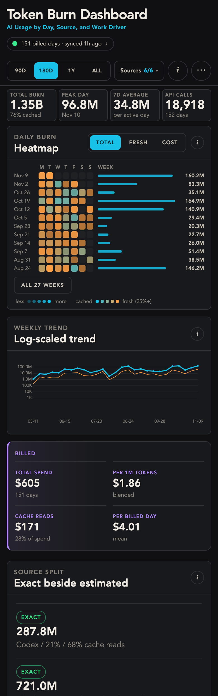
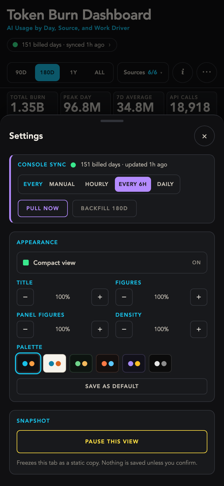

# Token Burn Dashboard

A local dashboard for AI token usage and spend across Codex, Claude Code, Claude
chat, ChatGPT, the Anthropic Console API and the OpenAI API, on one set of axes.
Every number is labeled by how much to trust it: **exact**, **billed**,
**derived** or **estimated**.

Everything runs locally. No usage data leaves the machine, and the one credential
involved never touches the repo.


<p align="center">
  
  &nbsp;
  
</p>

> The preview and `dashboard/data/daily-burn.sample.json` are fictional, generated
> data, so a fresh clone has something to render.

## Quick start

```bash
cd dashboard
npm install
npm run dev          # http://localhost:3000, renders the synthetic sample
```

To use your own numbers:

```bash
cp data/estimates.example.json data/private/estimates.json   # then edit it
npm run data                                                  # extract, fetch, merge
```

`npm run data` writes `data/daily-burn.json`, which is gitignored so your real
figures can't be committed by accident.

## Layout

- **Desktop:** the title row carries an **i** button (what the numbers mean and how much to
  trust each label) and **Pause**. Range, sources, and fidelity toggles sit in one or two thin
  rows, and Appearance starts collapsed, so the figures and charts are in view on load.
- **Phone (600px and below):** range, Sources, **i**, and a settings button stay pinned while
  you scroll. The heatmap turns into one row per week, newest first, with a bar for each
  week's total. Charts come before the billed block, panel notes sit behind their own **i**,
  and Console sync, Appearance, and Pause live in a bottom sheet. Compact view is on by
  default: the four figures share one row, heatmap cells and type are smaller, and the weekly
  trend fits on the first screen. Turn it off under Settings > Appearance.

## Commands

Run from `dashboard/`:

| Command | Does |
| --- | --- |
| `npm run data` | Everything below, then rebuild the rows |
| `npm run data:local` | Local logs only, no network |
| `npm run data:console` | Pull billed Anthropic usage and cost (resumes from cache) |
| `npm run data:console:full` | Re-pull 180 days of Anthropic usage (slow) |
| `npm run data:console:check` | Check what the stored admin key can reach, fetch nothing |
| `npm run data:openai -- DIR` | Import OpenAI usage/cost export CSVs from `DIR` |
| `npm run data:build` | Merge private inputs into `data/daily-burn.json` |

## Sources

- **Codex, Claude Code (CLI and desktop agent sessions):** exact, from local session logs.
- **Anthropic Console:** billed, from the Usage & Cost Admin API. Optional; needs an
  Admin API key from a Console organization, stored in the macOS Keychain (or
  `ANTHROPIC_ADMIN_KEY` elsewhere). See [docs/console-sync.md](docs/console-sync.md).
- **OpenAI API:** billed, from the platform's Usage export CSVs. API-key traffic only, UTC days.
- **Claude plan limits:** peak 5-hour and 7-day usage percent, from the desktop app's local history.
- **Claude chat, ChatGPT:** estimated, from your own figures in `data/private/estimates.json`.

Days bucket in your system timezone; override with `BURN_TZ`.

**Coming soon:** lanes for local LLMs and Decision models.

## Docs

| Doc | Covers |
| --- | --- |
| [docs/data-contract.md](docs/data-contract.md) | Row shape and column rules |
| [docs/pipeline.md](docs/pipeline.md) | How each script builds its part |
| [docs/console-sync.md](docs/console-sync.md) | Admin API setup, credentials, rate limits |
| [docs/privacy.md](docs/privacy.md) | What is safe to publish |
| [docs/private-data.md](docs/private-data.md) | What lives in `data/private/` |

Requires Node 20+.

## Credit

Based on the idea in [Build your own token-burn dashboard](https://unlock-ai.natebjones.com/guides/build-your-own-token-burn-dashboard)
by Nate B. Jones. This repo contains none of the guide's files; it is an
independent reimplementation that has since diverged.

## Licence

No licence is granted for the original guide's material, which is not included
here. Choose a licence for your own fork before publishing it.
